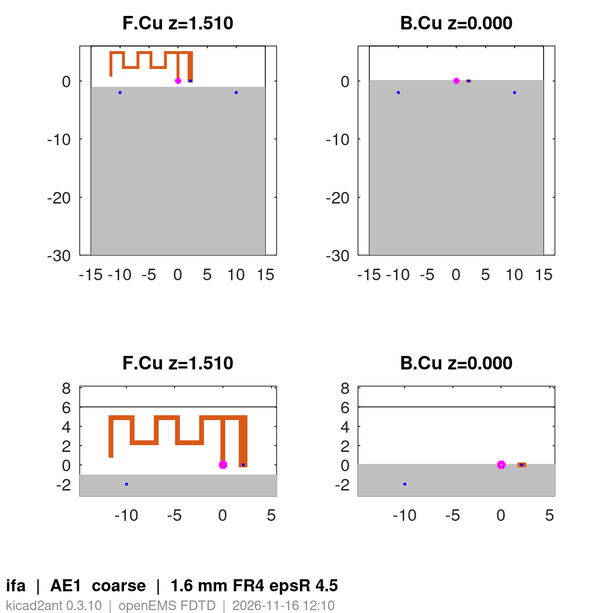
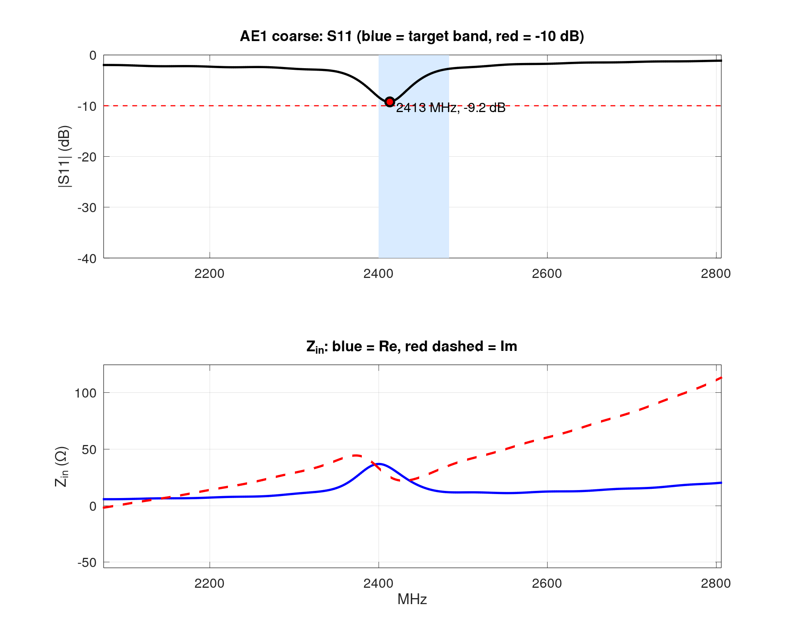
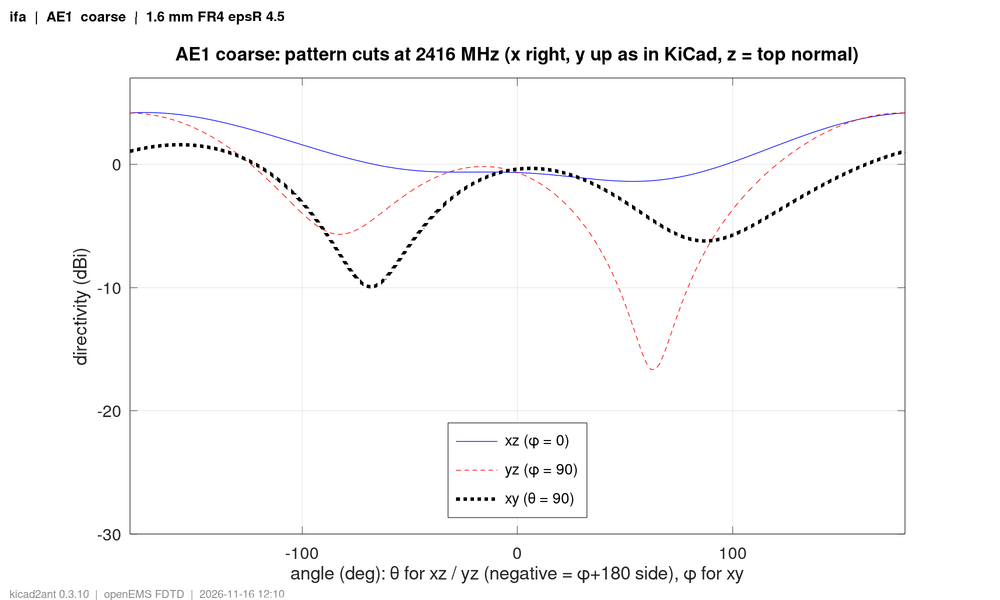

# kicad2ant

**Check how well the printed antenna on your KiCad board works, before you build the board.**

kicad2ant reads your `.kicad_pcb`, builds a 3D model of the antenna and its ground, simulates it with
[openEMS](https://openems.de) (a free field solver) and gives you the match (S11), the band it covers, its
gain and its radiation pattern. You enter no geometry by hand.

It runs three ways, all on the same engine:

- a **toolbar button in KiCad 10's PCB editor** (this is the plugin),
- a **command line** (`python scripts/kicad2ant.py myboard.kicad_pcb`),
- a **[Claude Code](https://claude.com/claude-code) skill** (`SKILL.md`), so Claude can run it for you.

| The model it builds | Match | Pattern |
|---|---|---|
|  |  |  |

*The example board in [examples/ti_ifa](examples/ti_ifa): TI's SWRA117D 2.4 GHz inverted-F antenna from KiCad's
own library on a 2-layer board, coarse run.*

Status: **0.1.0, testing.** Developed and tested on Windows with KiCad 10.0.8, Octave 11.1 and openEMS v0.37.
The Linux and macOS paths are written but not yet tested by the author. See [Known limits](#known-limits).

## What you get

- **S11, input impedance and a Smith chart**, the −10 dB band, and whether it covers your target band
- **Directivity, radiation efficiency, gain and realized gain** across the band
- **Pattern cuts** at the resonance, and a 3D pattern file for ParaView
- A **Touchstone `.s1p`** file to design the matching network from
- Your **VNA measurement overlaid** on the plots, if you have one
- A **model picture** (`*_geometry.png`) made in seconds, to check the port and the ground before a real run

What it reads from the board:

| From the board | Becomes |
|---|---|
| the antenna footprint's copper, on any layer: lines, arcs, polygons, pads of any shape, footprint zones | the antenna |
| the ground net's filled zones, tracks and vias, on every copper layer | the ground |
| Board Setup > Physical Stackup | one dielectric per copper pair (thickness, εr, loss) |
| Edge.Cuts, on the board and in footprints | the board outline and its cutouts |
| the feed pad | a 50 Ω port, to the ground under the pad or beside it |

Antenna kinds it suits: inverted-F (IFA), meandered IFA, meander, monopole, patch, and loops above 100 MHz.

## Requirements

Three free programs. None is bundled with kicad2ant.

| Program | Notes |
|---|---|
| **KiCad 10** | for the plugin. The command line only needs a `.kicad_pcb` file |
| **[GNU Octave](https://octave.org/download)** | tested with 11.1 |
| **[openEMS](https://github.com/thliebig/openEMS-Project/releases)** v0.37 or newer | **in a folder without spaces** |
| Python 3 | only for the command line. The plugin uses the Python that comes with KiCad |

Set up openEMS once:

- **Windows:** unzip the release to a folder without spaces, for example `C:\openEMS`. Then open Octave and run
  `cd C:\openEMS\matlab; setup`. This builds the file readers for your Octave version.
- **Linux / macOS:** install or build openEMS as its own instructions say (the usual place is `~/opt/openEMS`).

kicad2ant finds Octave and openEMS by itself: on `PATH`, in `C:\Program Files\GNU Octave` (the newest version),
and in `openEMS*` folders up to two levels deep on drives C to H. If it can't find them, tell it where they are:
in the plugin window (**Octave** and **openEMS folder**), or with the `OCTAVE` and `OPENEMS` environment
variables. The openEMS folder is the one that holds `matlab/` on Windows, and the install prefix (the folder
with `bin/` and `share/`) on Linux and macOS.

## Install the KiCad plugin

### With the Plugin and Content Manager (recommended)

1. Download `com.github.sijah.kicad2ant-0.1.0.zip` from [Releases](https://github.com/sijah/kicad2ant/releases),
   or build it yourself: `python kicad_plugin/build_pcm.py` (it lands in `dist/`).
2. KiCad → **Plugin and Content Manager** → **Install from File…** → pick the zip.
3. Open the PCB editor. The kicad2ant button is in the top toolbar, and under **Tools → External Plugins**.
   If it isn't there, use **Tools → External Plugins → Refresh Plugins**, or restart KiCad.

### By hand

Unzip the package and copy the **contents of its `plugins/` folder** into a new folder `kicad2ant` here:

| OS | Folder |
|---|---|
| Windows | `C:\Users\<user>\Documents\KiCad\10.0\scripting\plugins\kicad2ant\` |
| Linux | `~/.local/share/kicad/10.0/scripting/plugins/kicad2ant/` |
| macOS | `~/Documents/KiCad/10.0/scripting/plugins/kicad2ant/` |

kicad2ant is a classic KiCad action plugin (the SWIG runtime), so it needs no API setting and no extra Python
packages. KiCad plans to remove that runtime in KiCad 11; this version is for KiCad 10.

## Use it in KiCad

Your antenna must be a **footprint** (from KiCad's `RF_Antenna` library, or your own). Open the board and press
the kicad2ant button. The window stays open beside the editor.

1. **Mode → Check model**, then **Simulate.** In a few seconds you get a picture of the model: ground in grey,
   antenna in orange, the port in magenta. The port must sit on the feed pad, and the ground must be where you
   expect it. Do this first, every time.
2. **Mode → Coarse**, then **Simulate.** Minutes. Use it for tuning.
3. **Mode → Fine** for the numbers you quote. Much longer, and several GB of memory on large boards.

The window's fields:

| Field | What it does | Leave empty / default |
|---|---|---|
| **Mode** | Check model, Coarse or Fine | Coarse |
| **f0 (MHz)** | the design frequency | 2440 |
| **Band from / to (MHz)** | your target band; the result says whether the −10 dB band covers it | 2400 to 2483.5 at 2440 MHz, else f0 ± 2 % |
| **Ground net** | the ground net of this board | found by itself, see [below](#how-it-finds-the-antenna-the-feed-and-the-ground) |
| **Feed** | *Use selected pad*: click the antenna's feed pad in the editor, then this button. *Auto* goes back | the one antenna footprint, pad 1 |
| **Octave** | path to `octave-gui.exe` or `octave` | found by itself |
| **openEMS folder** | where openEMS is | found by itself |
| **Output in** | the folder the run folder `<board>_kicad2ant` is made in | next to the board file |
| **Show the 3D model…** | opens the model in openEMS's own viewer (AppCSXCAD) when the run ends: copper, board, port and mesh lines. With *Check model* that is seconds | off |
| **Theme** | System, Light or Dark colours for this window | System |

While it runs you see the phase, a progress bar read from openEMS's own log, and the elapsed time. **Stop** ends
the run and everything it started. When it is done the window shows the result lines and the S11 plot;
**Open results folder** has all the files, and **Open run folder** has the model files (`antenna_geom.m` is the
geometry Octave reads, `board.kicad_pcb` is the copy that was simulated).

Two things to know:

- **Your board file is not changed.** Simulate fills the zones (like pressing **B**) and saves a *copy* of the
  board as it is on screen into the run folder. The simulation runs on that copy.
- **The run folder** is `<board>_kicad2ant/` next to the board, or in the folder you give in **Output in**. openEMS can't work in a path with spaces, so for
  a board in such a path the run folder is `kicad2ant/<board>_<id>/` in your local app-data folder (Windows) or
  your home folder (Linux, macOS). The window shows where.

If a run fails, the red line says why. [Troubleshooting](#troubleshooting) lists the usual ones.

## Use it from the command line

In KiCad, **fill the zones (press B) and save** first. Then:

```
python scripts/kicad2ant.py myboard.kicad_pcb --mode dry                    # check the model first
python scripts/kicad2ant.py myboard.kicad_pcb                               # coarse run, minutes
python scripts/kicad2ant.py myboard.kicad_pcb --mode fine                   # numbers you quote
python scripts/kicad2ant.py myboard.kicad_pcb AE2 --f0 868 --band 863 870   # another antenna and band
```

On Windows you can also drag the `.kicad_pcb` onto `scripts/kicad2ant.bat` (a coarse 2.4 GHz run).

| Option | Default |
|---|---|
| `REF` | the one footprint whose reference is `AE*` / `ANT*`, or whose library name contains "antenna" |
| `--mode dry\|coarse\|fine` | `coarse`. `dry` builds the model and its picture only |
| `--f0 MHz`, `--band LO HI` | 2440, and 2400 to 2483.5. For another f0 the band is f0 ± 2 % |
| `--feed PAD` | pad `1` of the antenna footprint |
| `--gnd NET` | found by itself, see below |
| `--out DIR` | `myboard_kicad2ant/` next to the board. No spaces in the path |
| `--post` | redo only the post-processing on the saved fields, for example after adding `measured.s1p` |
| `--view` | open the 3D model in openEMS's viewer (AppCSXCAD) when the run ends |

All options and the model in detail: [docs/USAGE.md](docs/USAGE.md).

## How it finds the antenna, the feed and the ground

- **The antenna** is the one footprint whose reference starts with `AE` or `ANT` followed by a number, or whose
  library name contains "antenna". If there is none, or more than one, it stops and lists what it found: give
  the reference (command line), or click a pad of the antenna and press *Use selected pad* (plugin). The plugin
  takes any footprint you pick; if its name is unusual it asks you to check it is the antenna.
- **The feed** is pad `1` of that footprint, or the pad you picked.
- **The ground net** is, in this order: the net you gave; the net of the antenna's pad `2` (an IFA's shorting
  pin); a net called `GND`; otherwise the largest zone net with a usual ground name (`AGND`, `GNDA`, `DGND`,
  `VSS`, `0V`, …, also inside a sheet path such as `/rf/GND`). The result names the net it used.
- **The port** goes from the feed pad straight down or up to ground copper under it on another layer. If there
  is none, it goes sideways from the pad's edge to the nearest ground copper on the same layer. If that copper
  is only diagonal from the pad, it stops and says so, because such a port would not touch the ground.

## Results

Everything goes to `<run folder>/results/`:

| File | What it is |
|---|---|
| `<REF>_geometry.png` | the model, layer by layer: check this first |
| `<REF>_<mode>_summary.txt` | resonance, −10 dB band against your target, Zin at f0, whether the run converged, and the gain table |
| `<REF>_<mode>_s11_zin.png` | S11 and input impedance over frequency |
| `<REF>_<mode>_smith.png` | Smith chart, with f0 and the band edges marked |
| `<REF>_<mode>_pattern.png` | pattern cuts in the xz, yz and xy planes |
| `<REF>_<mode>.s1p` | Touchstone S11 at the feed pad, for matching-network design |
| `<REF>_<mode>_pattern.vtk` | the 3D pattern, for ParaView |

To compare with a measurement, save your VNA's 1-port file as `measured.s1p` in the run folder and run again
with `--post`. It is drawn over the S11 and Smith plots.

How to read it: a resonance away from f0 means the antenna's length is off, so retune it. A resonance at f0
with a poor S11 means it needs a matching network; design that from the `.s1p`.

## Known limits

State these with every result you share.

- **Only the antenna footprint and the ground net are modelled.** Other nets, components and any enclosure are
  left out. The board is bare, in air.
- **The matching network and the feed line are not in the model.** S11 is at the feed pad.
- **Copper is lossless**, so the radiation efficiency counts dielectric loss only.
- **Chip antennas can't be modelled.** They are a part, not copper.
- **Below 100 MHz it refuses to run** (NFC and other low-frequency loops): this kind of solver would need
  millions of steps there.
- **No spaces in the openEMS path or the run folder path.** That is an openEMS limit.
- **Coarse runs are for trends.** Do the final tuning on the real board with a VNA.
- **Not tested yet:** Linux, macOS, paths with non-English letters, and KiCad's Flatpak build (not supported).

## Troubleshooting

| The red line says | Do this |
|---|---|
| `Octave not found` | install Octave, or set **Octave** in the window (`OCTAVE` on the command line) |
| `openEMS Octave scripts not found` | install openEMS, or set **openEMS folder** (`OPENEMS`) |
| `openEMS is in a path with a space` | move openEMS to a folder without spaces |
| an error naming `h5readatt_octave` or `setup` | run `setup` once in openEMS's `matlab` folder, in the Octave that kicad2ant uses |
| `cannot pick the antenna footprint` | click a pad of the antenna, then *Use selected pad* (or give `REF`) |
| `needs exactly one pad "1" as the feed` | pick the feed pad with *Use selected pad* (or `--feed`) |
| `cannot tell the ground net` | type it in **Ground net** (or `--gnd`); the message lists the nets that have zones |
| `no filled … zones` | the ground net has no zone copper: check the net name, press **B**, save |
| `Edge.Cuts outline is not closed near …` | close the gap in the board outline at that point |
| `the nearest … copper to feed pad … is diagonal` | bring ground copper straight across from the feed pad, or under it |
| `no stackup` warning, or wrong εr | set the stackup in **Board Setup > Physical Stackup** |
| `NOT CONVERGED` in the result | the run hit its step limit; the numbers are unreliable. Check the model picture |

## For developers

```
python scripts/test_extract.py     # the board reader: stackup, outline, copper, ground, port, error messages
python kicad_plugin/test_core.py   # the plugin's helpers
python kicad_plugin/build_pcm.py   # the plugin package -> dist/
```

Both tests print `OK`, need nothing installed beyond Python 3, and run on every push
(`.github/workflows/test.yml`). The package follows KiCad's Plugin and Content Manager layout
(`metadata.json`, `plugins/`, `resources/icon.png`); the build also writes
`dist/metadata_gitlab_submission.json`, the metadata with the download fields KiCad's addon repository asks for.

| Path | What it is |
|---|---|
| `scripts/kicad2ant.py` | the command line: extracts, finds Octave and openEMS, runs |
| `scripts/extract_antenna.py` | `.kicad_pcb` → `antenna_geom.m` |
| `scripts/antenna_sim.m` | model, mesh, openEMS run, post-processing |
| `kicad_plugin/kicad2ant_plugin/` | the KiCad plugin: `__init__.py` (window), `core.py` (helpers) |
| `kicad_plugin/metadata.json`, `build_pcm.py` | the package's metadata and its builder |
| `examples/ti_ifa/` | an example board with its coarse results |
| `SKILL.md` | the Claude Code skill |
| `CHANGELOG.md` | what changed in each version |

## Licence and credits

GPL-3.0-or-later, see [LICENSE](LICENSE). openEMS and CSXCAD are © Thorsten Liebig and contributors.

Design notes were taken from [kicad2ems](https://github.com/lowprocess/kicad2ems) (air size, excitation past
the band, gain table) and Antmicro's [gerber2ems](https://github.com/antmicro/gerber2ems) (VNA overlay, Smith
chart, convergence check); the plugin's window borrows ideas from other antenna tools. No code was
copied from them.
