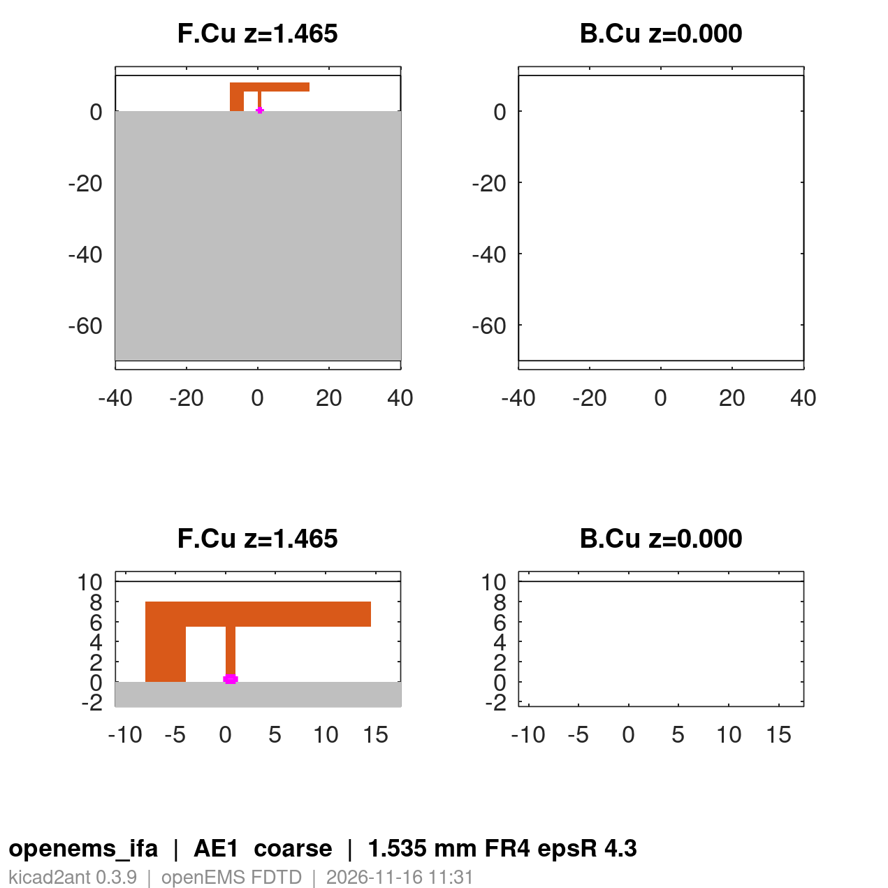

# kicad2ant

Simulate the printed antenna on your KiCad board before you send it to fab.

kicad2ant reads your `.kicad_pcb`, builds a 3D model of the antenna and its ground plane, and runs it through
[openEMS](https://openems.de), a free FDTD solver. You get S11, the band the antenna covers, its gain and its
radiation pattern. You don't have to enter any geometry by hand.

You can run it from a toolbar button in KiCad 10's PCB editor, from the command line
(`python scripts/kicad2ant.py myboard.kicad_pcb`), or as a [Claude Code](https://claude.com/claude-code) skill
(`SKILL.md`). All three use the same code underneath.

| Model | Match | Pattern |
|---|---|---|
|  |  |  |

*From [examples/openems_ifa](examples/openems_ifa): the 2.45 GHz inverted-F antenna from openEMS's own
`inverted_f.m` example, drawn as a KiCad board (coarse run). kicad2ant puts its resonance at 2438 MHz,
openEMS's script at 2420 MHz. A meandered IFA from KiCad's footprint library is in
[examples/ti_ifa](examples/ti_ifa), and [more example antennas](#example-antennas) are ready to simulate.*

kicad2ant is still being tested; see [CHANGELOG.md](CHANGELOG.md) for the current version. I develop it on
Windows with KiCad 10.0.8, Octave 11.1 and
openEMS v0.37. The Linux and macOS code paths are there but I haven't tried them yet. See
[Known limits](#known-limits).

## Why kicad2ant

Every tool in the chain is open source: kicad2ant, KiCad, GNU Octave and openEMS. There's no licence and no
account, and everything runs on your own PC, so nothing gets uploaded. It reads the antenna from the board file
itself, so there's no second copy of the design to keep in sync. Each run also leaves its model behind as
Octave files you can read, edit and run again. It's GPL-3.0, and issues and pull requests are welcome.

## What you get

- S11, input impedance and a Smith chart, the −10 dB band, and whether that band covers your target
- Directivity, radiation efficiency, gain and realized gain across the band
- Pattern cuts at resonance, plus a 3D pattern you can open in ParaView
- A Touchstone `.s1p` for designing the matching network
- Your VNA measurement drawn over the plots, if you have one
- A picture of the model (`*_geometry.png`), ready in a few seconds, so you can check the port and ground
  before a long run

Here's what it takes from the board:

| On the board | In the model |
|---|---|
| copper in the antenna footprint, on any layer: lines, arcs, polygons, pads, footprint zones | the antenna |
| filled zones, tracks and vias of the ground net, on every copper layer | the ground |
| Board Setup > Physical Stackup | one dielectric per copper pair (thickness, εr, loss) |
| Edge.Cuts, on the board and in footprints | the board outline and cutouts |
| the feed pad | a 50 Ω port to the ground under or beside it |

It works for inverted-F (IFA), meandered IFA, meander, monopole and patch antennas, and for loops above 100 MHz.

## Requirements

You need three free programs. kicad2ant doesn't bundle any of them.

| Program | Notes |
|---|---|
| KiCad 10 | for the plugin. The command line only needs the `.kicad_pcb` file |
| [GNU Octave](https://octave.org/download) | tested with 11.1 |
| [openEMS](https://github.com/thliebig/openEMS-Project/releases) v0.37 or newer | must be in a folder without spaces |
| Python 3 | command line only. The plugin uses KiCad's own Python |

Octave is not optional. openEMS is only the field solver: the 3D model, the mesh, the port, the run and every
result (S11, Zin, pattern, plots, `.s1p`) are made by Octave, through the Octave scripts in openEMS's `matlab`
folder. With openEMS alone a run stops at once with `Octave not found`.

MATLAB is not supported: kicad2ant starts Octave's command line, and MATLAB takes other options.

### Linking Octave to openEMS, once

Windows:

1. Install [GNU Octave](https://octave.org/download) with its installer (the default place,
   `C:\Program Files\GNU Octave\Octave-<version>`, is fine; that space is no problem).
2. Unzip the openEMS release into a folder **without spaces**, say `C:\openEMS`. It holds `openEMS.exe`,
   `AppCSXCAD.exe`, `matlab\` and `CTB\`.
3. Open Octave (the GUI from the Start menu) and type:
   ```
   cd C:\openEMS\matlab
   setup
   ```
   This builds openEMS's file readers for your Octave. Run it again whenever you update Octave or openEMS, with
   the same Octave kicad2ant uses (the newest one if you have several).
4. Check it: in KiCad open kicad2ant, **Setup** tab. It shows the Octave and openEMS it found and their
   versions, e.g.
   ```
   Octave 11.1.0 (C:\Program Files\GNU Octave\Octave-11.1.0\mingw64\bin\octave-gui.exe)
   openEMS v0.37.0 (C:\openEMS\openEMS.exe)
   ```
   From the command line: `python scripts/kicad2ant.py --check`. Every run's log starts with the same line.

Linux / macOS: install Octave from your package manager (`apt install octave`, `brew install octave`), and
install or build openEMS the way its docs say (usually into `~/opt/openEMS`). Then either set its folder in the
Setup tab (`OPENEMS=~/opt/openEMS` on the command line), or add its scripts to `~/.octaverc` once:

```
addpath('~/opt/openEMS/share/openEMS/matlab');
addpath('~/opt/openEMS/share/CSXCAD/matlab');
```

You don't need to add anything to Octave's path on Windows: each run adds openEMS's `matlab` and `CTB` folders
itself.

### When they are not found

kicad2ant looks for Octave and openEMS on its own: on `PATH`, in `C:\Program Files\GNU Octave` (newest version
first), and in any `openEMS*` folder up to two levels deep on drives C to H. If the Setup tab says one is not
found, fill in its field there (the **...** button browses) and click **Check again**. On the command line set
the `OCTAVE` and `OPENEMS` environment variables instead.

- **Octave**: the program, `octave-gui.exe` on Windows
  (`C:\Program Files\GNU Octave\Octave-11.1.0\mingw64\bin\octave-gui.exe`), `octave` elsewhere.
- **openEMS folder**: on Windows the folder containing `openEMS.exe` and `matlab\`; on Linux and macOS the
  install prefix (the folder with `bin/` and `share/`).

### Connecting the plugin to Octave and openEMS

The plugin runs the same `kicad2ant.py` in KiCad's own Python, so it finds Octave and openEMS the same way. Usually
there is nothing to set:

1. Do the steps above, then install the plugin (next section) and restart KiCad.
2. In the PCB editor click the kicad2ant toolbar button (or **Tools → External Plugins → kicad2ant**), and go to the **Setup** tab.
3. Read the two lines under the fields:
   - both show a version: you're connected, go to the **Run** tab;
   - `Octave not found`: click **...** next to **Octave** and pick `octave-gui.exe` (Windows, in
     `C:\Program Files\GNU Octave\Octave-<version>\mingw64\bin\`) or `octave` (Linux / macOS, e.g. `/usr/bin/octave`);
   - `openEMS: not found`: click **...** next to **openEMS folder** and pick the folder holding `openEMS.exe`
     (Windows) or the install prefix (Linux / macOS, e.g. `~/opt/openEMS`).
4. Click **Check again**. The paths are saved when you press Simulate or close the window, so you set them once.

If a run still fails with `h5readatt_octave` or `setup` in the log, step 3 of the linking above (`setup` in
openEMS's `matlab` folder) was skipped or done in another Octave.

## Installing the KiCad plugin

### Plugin and Content Manager

1. Download `com.github.sijah.kicad2ant-<version>.zip` from the latest
   [release](https://github.com/sijah/kicad2ant/releases/latest),
   or build it with `python kicad_plugin/build_pcm.py` (the zip ends up in `dist/`).
2. In KiCad, open the **Plugin and Content Manager**, click **Install from File…** and pick the zip.
3. Open the PCB editor. The kicad2ant button is in the top toolbar and under **Tools → External Plugins**. If
   you don't see it, try **Tools → External Plugins → Refresh Plugins** or restart KiCad.

### By hand

Unzip the package and copy what's inside its `plugins/` folder into a new `kicad2ant` folder here:

| OS | Folder |
|---|---|
| Windows | `C:\Users\<user>\Documents\KiCad\10.0\scripting\plugins\kicad2ant\` |
| Linux | `~/.local/share/kicad/10.0/scripting/plugins/kicad2ant/` |
| macOS | `~/Documents/KiCad/10.0/scripting/plugins/kicad2ant/` |

It's a classic action plugin (SWIG), so you don't need to enable the API or install any Python packages.
KiCad plans to drop the SWIG runtime in KiCad 11, so this version targets KiCad 10 only.

## Using it in KiCad

The antenna has to be a footprint, either from KiCad's `RF_Antenna` library or one of your own. Open the board
and click the kicad2ant button. The window stays open next to the editor.

Check the **PCB** line on the Run tab first: the board thickness, copper layers, εr and tanδ the simulation will
use, read from the saved board's stackup. Thickness and εr move the resonance a lot. If it says *no stackup set*
or *KiCad's default stackup*, enter your fab's stackup in **Board Setup > Physical Stackup** and save. The same
line is in the results summary, and the plots carry it in their heading (e.g. `0.8 mm FR4 epsR 4.4`).

1. Set **Mode** to *Check model* and click **Simulate**. A few seconds later you'll see the model, with the
   ground in grey, the antenna in orange and the port in magenta. Make sure the port is on the feed pad and the
   ground is where you expect. It's worth doing this every time.
2. Switch to *Fast* and simulate. It gives S11, Zin, the resonance and the −10 dB band in seconds to a
   minute, so use it for every tuning step.
3. Use *Coarse* to confirm the version you settled on. It adds gain, efficiency and the pattern, and takes minutes.
4. Use *Fine* for the numbers you report. It takes much longer and can use several GB of memory on a big board.

When a run ends the window switches to the **Results** tab: the summary, and a **Plot** list with S11 / Zin,
Smith, Pattern and Model. Click a plot to open it full size.

### Which mode?

| Mode | What it does | Use it |
|---|---|---|
| Check model | builds the model and draws it, no simulation (seconds) | first, to see the port and the ground |
| Fast | rougher model: S11, Zin, resonance and the −10 dB band, no gain or pattern | for each tuning step |
| Coarse | also directivity, efficiency, gain and pattern | to confirm the version you chose |
| Fine | finer mesh, runs to −50 dB (much longer, several GB) | for the numbers you report |

Measured on the two example boards (one run at a time, Windows laptop):

| Board | Fast | Coarse |
|---|---|---|
| `examples/ti_ifa` | 26 s, resonance 2391 MHz | 8 min, 2413 MHz |
| `examples/openems_ifa` | 13 s, 2408 MHz | 3.5 min, 2438 MHz |

Fast's resonance comes out about 1 % below Coarse.

`examples/openems_ifa` is the antenna from openEMS's own `inverted_f.m` example, drawn as a KiCad board, so
the two can be compared directly:

| | openEMS `inverted_f.m` | kicad2ant Coarse | kicad2ant Fast |
|---|---|---|---|
| resonance | 2420 MHz, −29.8 dB | 2438 MHz (+0.7 %), −28.2 dB | 2408 MHz (−0.5 %), −21.1 dB |
| Zin at 2450 MHz | 49.4 + 8.3j Ω | 52.1 + 4.8j Ω | 38.5 + 8.1j Ω |
| directivity, radiation efficiency | 2.55 dBi, 99 % | 2.83 dBi, 98–99 % | not computed |

Coarse lands within 1 % of openEMS's own model. Fast gets the resonance about right but the match and the
impedance only roughly, which is why it's for tuning steps and not for the numbers you report. While tuning,
compare Fast runs with Fast runs, then check the final version with Coarse.

The fields:

| Field | What it does | Default |
|---|---|---|
| Mode | Check model, Fast, Coarse or Fine (see [Which mode?](#which-mode)) | Fast |
| Ground net | the board's ground net | detected, see [below](#how-it-finds-the-antenna-the-feed-and-the-ground) |
| Feed | click the feed pad in the editor, then *Use selected pad*. *Auto* resets it | pad 1 of the antenna footprint |
| Octave | path to `octave-gui.exe` or `octave` | detected |
| openEMS folder | where openEMS lives | detected |
| Output in | where the `<board>_kicad2ant` run folder goes | next to the board file |
| Simulation tab: Target band | a preset (table below) or Custom: f0, the band and the match limit. The result tells you if the band where S11 is below the limit covers your band. The Run tab shows it on the line above *Edit* | 2.4 GHz |
| Show the 3D model… | opens the model in openEMS's viewer (AppCSXCAD) when the run finishes: copper, board, port and mesh. With *Check model* that's a few seconds | off |
| Theme | System, Light or Dark | System |

| Preset | f0 (MHz) | Band (MHz) | Match limit |
|---|---|---|---|
| 433 MHz ISM | 433.92 | 433.05–434.79 | −6 dB |
| 868 MHz SRD (EU, LoRa) | 868 | 863–870 | −6 dB |
| 915 MHz ISM (US, LoRa) | 915 | 902–928 | −6 dB |
| GNSS L5 / E5a | 1176.45 | 1164–1189 | −6 dB |
| GNSS L1 / E1 | 1575.42 | 1559–1610 | −6 dB |
| 2.4 GHz (BLE, Wi-Fi, Zigbee) | 2440 | 2400–2483.5 | −10 dB |
| 5 GHz Wi-Fi | 5500 | 5150–5850 | −10 dB |
| 6 GHz Wi-Fi 6E | 6525 | 5925–7125 | −10 dB |
| UWB channel 5 | 6489.6 | 6240–6739 | −10 dB |
| UWB channel 9 | 7987.2 | 7738–8237 | −10 dB |

The match limit is how low S11 must be over the whole band: −10 dB (VSWR 1.9, 90 % of the power accepted) is the
usual figure at 2.4 GHz and up; −6 dB (VSWR 3, 75 %) is the usual one for small sub-GHz and GNSS antennas, which
rarely reach −10 dB over the band. Below 1 GHz the board's ground is part of the antenna, so the result depends on
the board's size, and runs take several times longer than at 2.4 GHz.

During a run you see the current phase, a progress bar (taken from openEMS's log) and the elapsed time.
**Stop** kills the run and everything it started. When it's done, the window shows the results and the S11
plot. **Open results folder** takes you to the output files, and **Open run folder** to the model:

| File | What it is |
|---|---|
| `antenna_geom.m` | geometry read from the board: antenna, ground, stackup, outline, port |
| `antenna_sim.m` | a copy of the openEMS model and run script that was used |
| `run_sim.m` | this run's settings. Run it in Octave to repeat the simulation, or edit it first |
| `board.kicad_pcb` | the copy of the board that was simulated |
| `sim_<mode>/` | openEMS's files: `antenna.xml` (the model), the log and field dumps |

Two things to know:

- Your board file isn't touched. Simulate refills the zones (same as pressing **B**), saves a copy of the
  board as it is on screen into the run folder, and simulates that copy.
- The run folder is `<board>_kicad2ant/` next to the board, or wherever **Output in** points. openEMS can't
  handle spaces in paths, so if your board's path has one, the run goes into `kicad2ant/<board>_<id>/` under
  your local app-data folder (Windows) or your home folder (Linux, macOS). The window tells you where.

If a run fails, the red line explains why. The usual causes are listed under [Troubleshooting](#troubleshooting).

## Using it from the command line

Fill the zones in KiCad (press **B**) and save first. Then:

```
python scripts/kicad2ant.py myboard.kicad_pcb --mode dry                    # check the model first
python scripts/kicad2ant.py myboard.kicad_pcb                               # fast: S11 only, under a minute
python scripts/kicad2ant.py myboard.kicad_pcb --mode coarse                 # adds gain and pattern, minutes
python scripts/kicad2ant.py myboard.kicad_pcb --mode fine                   # numbers you report
python scripts/kicad2ant.py myboard.kicad_pcb AE2 --f0 868                   # another antenna, the 868 MHz band
```

On Windows you can also drop a `.kicad_pcb` onto `scripts/kicad2ant.bat` for a fast 2.4 GHz run.

| Option | Default |
|---|---|
| `REF` | the single footprint with an `AE*` / `ANT*` reference, or with "antenna" in its library name |
| `--mode dry\|fast\|coarse\|fine` | `fast`. `dry` only builds the model and its picture |
| `--f0 MHz`, `--band LO HI` | 2440 and 2400–2483.5. At a preset's f0 (868, 915, 1575.42 …, table above) its band; for any other f0, f0 ± 2 % |
| `--match DB` | −6 below 2 GHz, −10 above: S11 must be below it over the band |
| `--feed PAD` | pad `1` of the antenna footprint |
| `--gnd NET` | detected, see below |
| `--case ER TAND WALL SIDE TOP BOTTOM` | none: the board in air. A plastic case as a box shell around the board: εr, loss tangent, wall thickness and the gaps to the board at the sides, on top (F.Cu side) and below, mm; e.g. `--case 3 0.01 2 1 1 1` for ABS. In the plugin: **Around the board: Plastic case** |
| `--out DIR` | `myboard_kicad2ant/` next to the board. No spaces in the path |
| `--post` | redo only the post-processing on saved fields, e.g. after adding `measured.s1p` |
| `--view` | open the 3D model in AppCSXCAD when the run finishes |

Full option list and model details: [docs/USAGE.md](docs/USAGE.md).

## Example antennas

`examples/antenna_footprints.pretty/` is a KiCad footprint library of printed antennas: IFAs and meandered IFAs
(TI, Silicon Labs and others), monopoles, a patch, a Yagi, a helical, a log-periodic and UWB antennas, from
868 MHz to 10 GHz. Each footprint's description says what the antenna is and, where there is one, the app note
it comes from and the board it was designed for. Each one also has a ready-made board in `examples/<name>/` that you can simulate straight away:

```
python scripts/kicad2ant.py examples/ti_dn007_ifa/ti_dn007_ifa.kicad_pcb --mode dry
```

### Starting from a footprint only

`scripts/fp2board.py` puts an antenna footprint (`.kicad_mod`) on a bare board that kicad2ant can simulate. It's
how the example boards were made:

```
python scripts/fp2board.py "My antenna.kicad_mod" --thickness 1.6 --er 4.4
```

Copper polygons holding a pad 2 become filled GND zones; without a pad 2, the largest polygon is the ground.
The rest stays the antenna footprint `ANT1`, with pad 1 as the feed (net RF). The outline comes from F.Fab and
the copper, and the board has 2 layers, or 4 when an inner layer is used. Board thickness, εr and tanδ default to
1.6 mm, 4.5 and 0.02. Always do a `--mode dry` run on the result and check that the port sits on the feed. If it
doesn't, `--list` numbers the copper polygons, `--feed-at X Y` places the feed pad, and `--ground I,J` makes more
polygons ground. `python scripts/fp2board.py --help` lists every option.

## How it finds the antenna, the feed and the ground

- Antenna: the one footprint whose reference is `AE` or `ANT` plus a number, or whose library name contains
  "antenna". If it finds none or several, it stops and lists them. Then give the reference on the command
  line, or in the plugin click a pad of the antenna and press *Use selected pad*. The plugin accepts any
  footprint you pick, but asks you to confirm if the name doesn't look like an antenna.
- Feed: pad `1` of that footprint, or the pad you picked.
- Ground net, in this order: the net you gave it, then the net on the antenna's pad `2` (an IFA's shorting
  pin), then a net named `GND`, then the largest zone net with a common ground name (`AGND`, `GNDA`, `DGND`,
  `VSS`, `0V`, …, including inside a sheet path like `/rf/GND`). The result says which net it used.
- Port: from the feed pad straight down or up to ground copper on another layer. If there isn't any, it goes
  sideways from the pad edge to the nearest ground copper on the same layer. If that copper is only diagonal
  from the pad, it stops, because that port wouldn't actually touch ground.

## Results

Everything lands in `<run folder>/results/`:

| File | What it is |
|---|---|
| `<REF>_geometry.png` | the model, layer by layer. Look at this first |
| `<REF>_<mode>_summary.txt` | resonance, the matched band (S11 below the limit) vs. your target, Zin at f0, convergence, gain table (not in Fast) |
| `<REF>_<mode>_s11_zin.png` | S11 and input impedance around f0, with the target band shaded and the resonance marked |
| `<REF>_<mode>_smith.png` | Smith chart with f0 and band edges marked |
| `<REF>_<mode>_pattern.png` | pattern cuts in the xz, yz and xy planes (not in Fast) |
| `<REF>_<mode>.s1p` | Touchstone S11 at the feed pad, for matching-network design |
| `<REF>_<mode>_pattern.vtk` | 3D pattern for ParaView (not in Fast) |

To compare against a measurement, save your VNA's 1-port file as `measured.s1p` in the run folder and rerun
with `--post`. It's drawn over the S11 and Smith plots. More files named `measured1.s1p`, `measured2.s1p`, …
are drawn too, each in its own colour with its name in the legend, and the summary gives each one's
resonance and its distance from the simulation. Antenna versions are compared by themselves: each run first
keeps the result it replaces in `history/<REF>_<mode>_<date-time>.s1p`, and the last two of these are drawn
the same way. To keep an older one in the plots, copy it from `history/` to `measured1.s1p`.

Reading the result: if resonance is away from f0, the antenna is the wrong length and needs retuning. If it
resonates at f0 but S11 is poor, it needs a matching network, which you can design from the `.s1p`.

## Known limits

Mention these whenever you share a result.

- Only the antenna footprint and the ground net are modelled. Other nets and components are left out. The board
  is in air, or in a plain box-shaped plastic case (`--case`); ribs, bosses, screws and curved walls are not
  modelled. Plastic lowers the resonance, by several % when it is close to the antenna, so tune with the case on.
- The matching network and feed line aren't modelled. S11 is at the feed pad.
- Copper is lossless, so radiation efficiency only includes dielectric loss.
- Chip antennas can't be modelled, since they're a component and not copper.
- It won't run below 100 MHz (NFC and other low-frequency loops). An FDTD solver would need millions of
  timesteps there.
- No spaces in the openEMS path or the run folder path. That's an openEMS limitation.
- Fast and Coarse runs show trends. Do the final tuning on the real board with a VNA.
- Not tested yet: Fine mode, Linux, macOS, paths with non-English characters, and KiCad's Flatpak build (not
  supported).
- The far field (directivity, efficiency, gain) can be off right at resonance on some boards; this is being
  looked into. S11 and Zin are not affected.

## Troubleshooting

| Red line says | Fix |
|---|---|
| `Octave not found` | install Octave, or set **Octave** in the Setup tab (`OCTAVE` on the command line). See [Linking Octave to openEMS](#linking-octave-to-openems-once) |
| `Octave not found at <path>` | the Octave path in the Setup tab (or `OCTAVE`) is wrong: fix it, or clear it to find Octave by itself |
| `openEMS Octave scripts not found` | install openEMS, or set **openEMS folder** (`OPENEMS`) |
| `openEMS is in a path with a space` | move openEMS to a folder without spaces |
| an error mentioning `h5readatt_octave` or `setup` | run `setup` once in openEMS's `matlab` folder, using the Octave kicad2ant uses |
| `cannot pick the antenna footprint` | click a pad of the antenna, then *Use selected pad* (or give `REF`) |
| `needs exactly one pad "1" as the feed` | pick the feed pad with *Use selected pad* (or `--feed`) |
| `cannot tell the ground net` | type it into **Ground net** (or `--gnd`). The message lists nets that have zones |
| `no filled … zones` | the ground net has no zone copper. Check the net name, press **B**, save |
| `Edge.Cuts outline is not closed near …` | close the gap in the board outline at that point |
| `the nearest … copper to feed pad … is diagonal` | put ground copper straight across from the feed pad, or under it |
| `no stackup` warning, or wrong εr | set up **Board Setup > Physical Stackup** |
| `NOT CONVERGED` in the result | the run hit its step limit and the numbers aren't reliable. Check the model picture |
| `another kicad2ant run is using …` | a run is already going in that run folder. Wait for it, or give another `--out` |

Anything else: click **Copy log** and paste the log into an issue.

## For developers

```
python scripts/test_extract.py     # board reader: stackup, outline, copper, ground, port, error messages
python scripts/test_mesher.py      # mesh rules
python kicad_plugin/test_core.py   # plugin helpers
python kicad_plugin/build_pcm.py   # build the plugin package into dist/
```

The tests print `OK`, need only Python 3, and run on every push (`.github/workflows/test.yml`). The package
uses KiCad's Plugin and Content Manager layout (`metadata.json`, `plugins/`, `resources/icon.png`). The build
also writes `dist/metadata_gitlab_submission.json`, which is the metadata plus the download fields KiCad's
addon repository wants.

| Path | What it is |
|---|---|
| `scripts/kicad2ant.py` | command line: extracts, finds Octave and openEMS, runs |
| `scripts/extract_antenna.py` | `.kicad_pcb` → `antenna_geom.m` |
| `scripts/mesher.py` | mesh lines from the copper edges, written into `antenna_geom.m` |
| `scripts/antenna_sim.m` | model, openEMS run, post-processing |
| `scripts/fp2board.py` | antenna footprint (`.kicad_mod`) → simulatable board |
| `scripts/fp_tools.py` | tuning helpers for a board copy (runs in KiCad's Python): refill zones, save a board footprint to a library |
| `kicad_plugin/kicad2ant_plugin/` | the plugin: `__init__.py` (window), `core.py` (helpers) |
| `kicad_plugin/metadata.json`, `build_pcm.py` | package metadata and builder |
| `examples/antenna_footprints.pretty/` | the example antenna footprint library |
| `examples/<name>/` | a board per example antenna |
| `examples/ti_ifa/` | example board with coarse results |
| `examples/openems_ifa/` | openEMS's own `inverted_f.m` antenna as a KiCad board, with fast and coarse results |
| `docs/` | `USAGE.md` (the model in detail), `ARCHITECTURE.md`, `MESHING.md` and `MESHER.md` (how the mesh is made) |
| `SKILL.md` | the Claude Code skill |
| `CHANGELOG.md` | changes per version |

## Licence and credits

GPL-3.0-or-later, see [LICENSE](LICENSE). openEMS and CSXCAD are © Thorsten Liebig and contributors.

Some design ideas came from [kicad2ems](https://github.com/lowprocess/kicad2ems) (air box size, excitation
beyond the band, gain table) and Antmicro's [gerber2ems](https://github.com/antmicro/gerber2ems) (VNA overlay,
Smith chart, convergence check), and the mesh rules for lines that fall too close together (port planes
always kept, two close edge lines merged midway) from [OpenEMSH](https://github.com/Open-RFlab/openemsh).
No code was copied from any of them.
